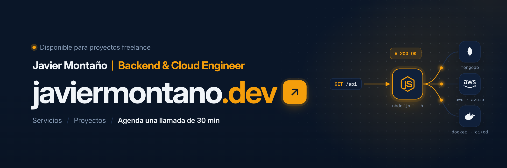
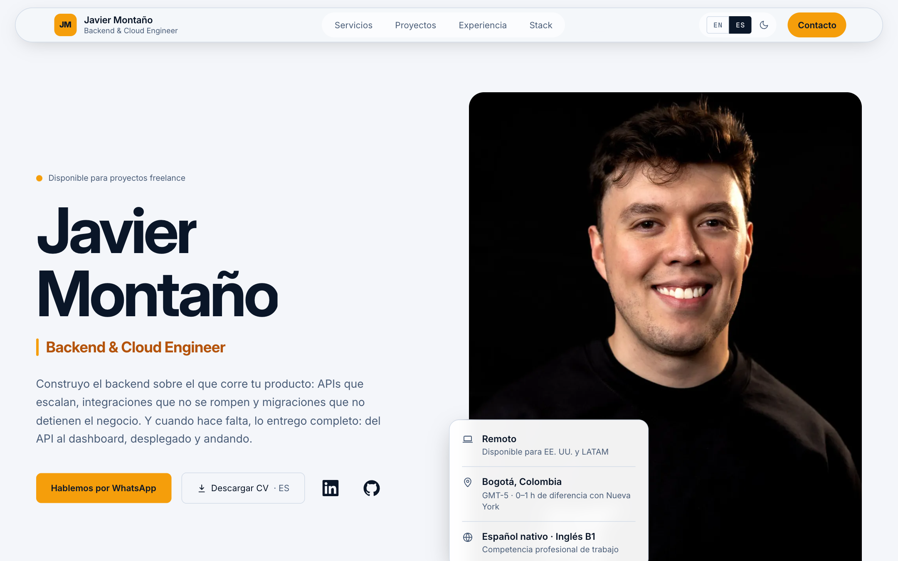
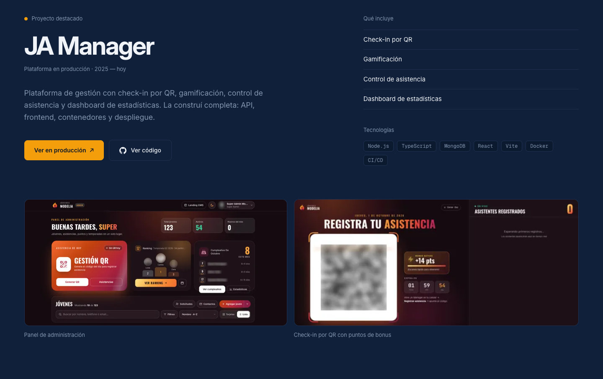
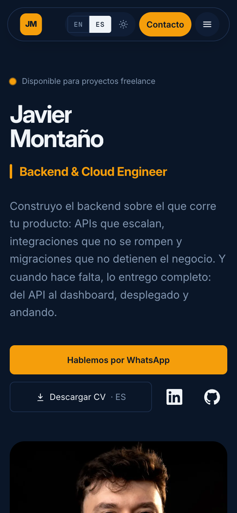
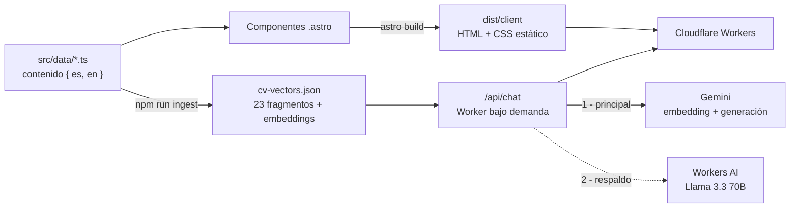
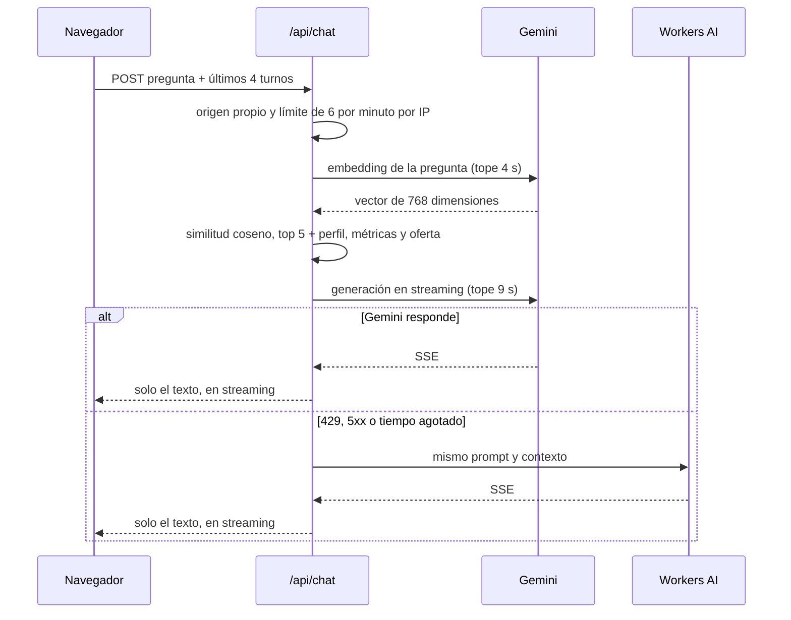

<a href="https://javiermontano.dev"></a>

# Javier Montaño — Portafolio

Sitio personal de **Javier Montaño**, Backend & Cloud Engineer (Bogotá, Colombia).
Presenta servicios, proyectos, experiencia y formas de contacto en **español e inglés**, con
un **asistente de IA** que responde preguntas sobre su perfil a partir del contenido del sitio.


<div align="center">

</div>

> **En línea:** https://javiermontano.dev

## Contenido

- [Qué hace](#qué-hace)
- [Cómo funciona](#cómo-funciona)
- [Cómo está hecho](#cómo-está-hecho)
- [Requisitos](#requisitos)
- [Variables de entorno](#variables-de-entorno)
- [Probarlo en local](#probarlo-en-local)
- [Despliegue](#despliegue)
- [Decisiones que vale la pena mirar](#decisiones-que-vale-la-pena-mirar)
- [Estructura](#estructura)
- [Solución de problemas](#solución-de-problemas)
- [Accesibilidad](#accesibilidad)

## Qué hace

- Presenta servicios, proyectos destacados, experiencia, stack y métricas, con una agenda de
  llamada gratuita de 30 min (Cal.com) como siguiente paso.
- Funciona en dos idiomas: español en `/` e inglés en `/en/`, con modo claro y oscuro.
- Incluye un **chat con IA** que responde solo con lo que dice el sitio. Cuando no sabe algo
  o el visitante quiere contratar, invita a agendar la llamada.
- Es estático salvo un endpoint, `/api/chat`, que corre como Worker en Cloudflare.

<div align="center">

<br /><br />

</div>

Se adapta desde 390 px de ancho.

## Cómo funciona

Todo el contenido son archivos TypeScript y las páginas se generan en el build. El único
código de servidor es `/api/chat`: un RAG pequeño cuyos vectores se calculan una vez y se
guardan como JSON en el repo.



Una pregunta al chat sigue este camino:



Si el embedding falla, no se pierde la respuesta: el corpus completo cabe en el contexto
y se envía entero. La cabecera `x-chat-engine` dice qué modelo respondió.

En el navegador, el único JavaScript es el chat ([`Chat.astro`](src/components/Chat.astro),
sin framework) y el movimiento ([`src/scripts/`](src/scripts)). Sin ese JavaScript, o con
`prefers-reduced-motion`, la página queda completa y estática.

## Cómo está hecho

| Pieza | Elección |
|---|---|
| Framework | Astro 7: sitio estático y un endpoint con `prerender = false` |
| Estilos | Tailwind v4 con tokens propios |
| Tipografía | Inter y Geist Mono, auto-hospedadas |
| Movimiento | GSAP + ScrollTrigger, Lenis para el scroll |
| Logos | simple-icons e iconify, resueltos en tiempo de compilación |
| Chat | Gemini (`gemini-embedding-001` + `gemini-3.8-flash`), respaldo en Workers AI |
| Hosting | Cloudflare Workers con `@astrojs/cloudflare` |

## Requisitos

| Qué | Para qué | Costo |
|---|---|---|
| Node ≥ 22.12 | Build y desarrollo | Gratis |
| Cuenta de Cloudflare | Hosting, Workers AI y límite de peticiones | El plan gratuito basta (Workers AI: 10.000 neuronas al día) |
| Clave de Gemini ([Google AI Studio](https://aistudio.google.com/apikey)) | Embeddings y respuestas del chat | El nivel gratuito basta para un portafolio |

Sin clave de Gemini, el sitio funciona igual; solo el chat responde `503 unavailable`.

## Variables de entorno

| Variable | ¿Obligatoria? | Descripción y de dónde sale |
|---|---|---|
| `GEMINI_API_KEY` | Para el chat | Clave de Google AI Studio. En local va en `.dev.vars` (ignorado por git). En producción se guarda con `wrangler secret put`. |
| `GEMINI_MODEL` | Ya definida | Modelo de generación, en [`wrangler.jsonc`](wrangler.jsonc). Si Google lo renombra, se cambia ahí sin tocar código. |
| `GEMINI_EMBED_MODEL` | Ya definida | Modelo de embeddings. Debe coincidir con el usado en `npm run ingest`. |
| `FALLBACK_MODEL` | Ya definida | Modelo de Workers AI para el respaldo. |

Los bindings `AI` (Workers AI) y `CHAT_LIMITER` (6 peticiones por minuto por IP) también
están en `wrangler.jsonc`. El código funciona sin ellos: sin `AI` no hay respaldo, y sin
`CHAT_LIMITER` no hay límite.

## Probarlo en local

```sh
npm install
echo 'GEMINI_API_KEY=<tu-clave>' > .dev.vars
npm run dev       # http://localhost:4321
```

Probar el chat sin abrir el navegador:

```sh
curl -X POST http://localhost:4321/api/chat \
  -H 'content-type: application/json' \
  -d '{"message":"¿Con qué lenguaje trabaja?","lang":"es"}'
```

Para ver el respaldo de Workers AI sin esperar a que Gemini falle, añade
`-H 'x-force-fallback: 1'`. Esa cabecera solo funciona en desarrollo y el build la
elimina.

Otros comandos:

```sh
npm run build              # genera dist/client (estático) y dist/server (Worker)
npm run preview            # sirve el build
npm run ingest -- --dry    # lista los fragmentos del chat, sin clave ni API
npm run ingest             # recalcula src/data/cv-vectors.json
```

Cuando cambie el contenido en `src/data/*.ts`, corre `npm run ingest` para que el chat
diga lo mismo que la página.

## Despliegue

```sh
npx wrangler login
npx wrangler secret put GEMINI_API_KEY    # solo la primera vez
npx astro build && npx wrangler deploy
```

El build deja la configuración final del Worker en `dist/server/wrangler.json`, y
`wrangler deploy` la toma de ahí: sube `dist/client` como assets y `/api/chat` como código.

## Decisiones que vale la pena mirar

| Decisión | Por qué |
|---|---|
| Contenido separado de la vista | Todo el texto vive en `src/data/*.ts` con la forma `{ es, en }`. Añadir un proyecto es una entrada en un arreglo. |
| Un solo origen para el sitio y el chat | [`chat-corpus.ts`](src/lib/chat-corpus.ts) arma los fragmentos con los mismos datos que pintan la página, así que nada se escribe dos veces. |
| Vectores en un JSON, sin base vectorial | Con 23 fragmentos, la similitud coseno en memoria tarda microsegundos. Una base vectorial sería más infraestructura que problema. |
| Topes de espera cortos y respaldo inmediato | Saturado, Gemini llegó a tardar 64 s en dar el primer texto, y Workers AI responde en 2 a 7 s. Pasados 9 s, se cambia de modelo. |
| El 429 no se reintenta | Si el cupo está agotado, insistir solo empeora el límite. Se pasa directo al respaldo. |
| Contexto mínimo siempre presente | Preguntas como "¿cuánto cobra?" no se parecen al fragmento de "cómo empezar", pero la respuesta correcta es invitar a la llamada. |
| Mensajes del visitante tratados como no confiables | El prompt ignora instrucciones para cambiar de rol, y el endpoint rechaza otros orígenes, cuerpos de más de 8 KB y preguntas de más de 400 caracteres. |
| Dos idiomas sin framework de i18n | Español en `/` e inglés en `/en/`, con `hreflang`, sitemap por idioma y CV en el idioma que se lee. La lógica cabe en [`src/i18n/config.ts`](src/i18n/config.ts). |
| Modo claro y oscuro con tokens | Ningún componente decide su color. El tema se resuelve antes de pintar, sin destello, aunque `localStorage` esté bloqueado. |
| Logos en un solo color | Varias marcas casi negras desaparecerían sobre el fondo navy, así que se aplanan a `currentColor` en el build. Lo que no tiene logo real se muestra con su nombre, nunca con una marca inventada. |
| Sin formulario de contacto | El contacto son enlaces directos y una agenda, sin datos de terceros que custodiar. |

## Estructura

```text
src/
├── components/      # Secciones y piezas reutilizables (.astro), incluido Chat.astro
├── data/            # Todo el contenido, bilingüe, y cv-vectors.json (generado)
├── i18n/            # Idiomas y textos de interfaz
├── layouts/         # Documento base: SEO, tema, accesibilidad
├── lib/             # Logos en build y corpus del chat
├── pages/           # / (es), /en/ (en), 404 y api/chat.ts
├── scripts/         # Movimiento en el cliente (spotlight, revelados)
└── styles/          # Tokens y utilidades globales
scripts/ingest.mjs   # Calcula los embeddings del contenido
wrangler.jsonc       # Worker, variables, Workers AI y límite de peticiones
```

## Solución de problemas

| Síntoma | Causa y arreglo |
|---|---|
| El chat responde `503 {"error":"unavailable"}` | Falta `GEMINI_API_KEY`. Agrégala en `.dev.vars` en local o con `wrangler secret put` en producción. |
| El chat dice "ocupado" (`busy`) | Se agotaron el cupo gratuito de Gemini y el de Workers AI del día. Se recupera solo. |
| El chat responde con datos viejos | El contenido cambió, pero no los vectores. Corre `npm run ingest` y vuelve a desplegar. |
| Todas las respuestas traen `x-chat-engine: workers-ai` | Gemini está agotando el tope de espera o devuelve 429. Es el comportamiento esperado; revisa el cupo en AI Studio. |
| `429 rate_limited` | Más de 6 preguntas por minuto desde la misma IP. |
| `npm run ingest` falla con "Falta GEMINI_API_KEY" | Crea `.dev.vars` o exporta la variable. Para solo revisar fragmentos, usa `--dry`. |

## Accesibilidad

Contraste AA verificado en ambos modos, foco visible en todo elemento interactivo y
navegación completa con teclado, incluido el carrusel, que además se puede pausar. Las
descripciones de imagen están en los dos idiomas.

---

Código abierto como referencia. El contenido, las imágenes y el CV son © Javier Montaño.
Gemini, Cloudflare y las demás marcas mencionadas pertenecen a sus dueños; este proyecto no
está afiliado a ellas.
